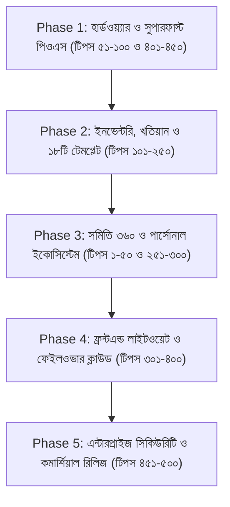

# HisabKitab 360 - Master 500 Enterprise Research & Upgrade Manifesto
*(হিসাবকিতাব ৩৬০ - সম্পূর্ণ সিস্টেম অডিট, ৫০০ টিপস, ভবিষ্যৎ রূপরেখা ও মেগা এনসাইক্লোপিডিয়া)*

> **ডকুমেন্ট স্ট্যাটাস:** মাস্টার রিসার্চ ও ফেইজভিত্তিক রূপরেখা (Master Research & Phased Roadmap)  
> **প্রস্তুত তারিখ:** ৩ নভেম্বর ২০২৬  
> **সংস্করণ:** v2.4.8+ এন্টারপ্রাইজ রেডি  
> **উদ্দেশ্য:** পার্সোনাল, বিজনেস, ১৮টি ইন্ডাস্ট্রি টেমপ্লেট, ব্যাকএন্ড, ফ্রন্টএন্ড, হার্ডওয়্যার ব্রিজ, ক্লাউড ফেইলওভার ও ইউআই/ইউএক্স-এর এ-টু-জেড ৫০০টি প্রফেশনাল টিপস, সমস্যা, সমাধান ও সুবিধার বিশদ ডিরেক্টরি।

---

## সূচিপত্র ও ডোমেইন বিভাজন (Table of Contents)

1. [ডোমেইন ১: পার্সোনাল মোড ও ফ্যামিলি ফাইন্যান্স ইকোসিস্টেম (টিপস ১ - ৫০)](#domain-1)
2. [ডোমেইন ২: পিওএস টার্মিনাল, মোবাইল সেলস ও ক্যাশ কাউন্টার আল্ট্রা-স্পিড (টিপস ৫১ - ১০০)](#domain-2)
3. [ডোমেইন ৩: ইনভেন্টরি, ড্যামেজ কন্ট্রোল, মাল্টি-ইউওএম ও সাপ্লাই চেইন (টিপস ১০১ - ১৫০)](#domain-3)
4. [ডোমেইন ৪: পাইকারি দেনা-পাওনা লেজার, ডেবিট নোট ও ডাবল-এন্ট্রি অ্যাকাউন্টিং (টিপস ১৫১ - ২০০)](#domain-4)
5. [ডোমেইন ৫: ১৮টি স্পেশালাইজড ইন্ডাস্ট্রি টেমপ্লেট অপ্টিমাইজেশন (টিপস ২০১ - ২৫০)](#domain-5)
6. [ডোমেইন ৬: সমিতি ৩৬০ মাইক্রোফাইন্যান্স ও সমবায় সঞ্চয় ইকোসিস্টেম (টিপস ২৫১ - ৩০০)](#domain-6)
7. [ডোমেইন ৭: ফ্রন্টএন্ড লাইটওয়েট অপ্টিমাইজেশন ও ৬০ FPS পারফরম্যান্স (টিপস ৩০১ - ৩৫০)](#domain-7)
8. [ডোমেইন ৮: ক্লাউড, হাইব্রিড মেশ সিঙ্ক, ফেইলওভার ও রেজিলিয়েন্স (টিপস ৩৫১ - ৪০০)](#domain-8)
9. [ডোমেইন ৯: আধুনিক W3C ওয়েব এপিআই ও হার্ডওয়্যার ব্রিজিং (টিপস ৪০১ - ৪৫০)](#domain-9)
10. [ডোমেইন ১০: মোবাইল ইউআই রেসপন্সিভনেস, সেফ-এরিয়া ও কমার্শিয়াল সিকিউরিটি (টিপস ৪৫১ - ৫০০)](#domain-10)

---

## ডোমেইন ১: পার্সোনাল মোড ও ফ্যামিলি ফাইন্যান্স ইকোসিস্টেম (টিপস ১ - ৫০)

### ১. স্মার্ট এআই বাজেট প্রেডিকশন
- **সমস্যা:** ব্যবহারকারী প্রতি মাসের শুরুতে আন্দাজে খরচ বাজেট তৈরি করেন যা মাসের মাঝামাঝি শেষ হয়ে যায়।
- **সমাধান:** পূর্ববর্তী ৩ মাসের খরচের ট্রেন্ড দেখে ক্যাটাগরিভিত্তিক অটোমেটিক স্মার্ট বাজেট রেকমেন্ডেশন ইঞ্জিন যুক্ত করা।
- **সুবিধা:** মাসের ২০ তারিখের আগেই বাজেট ফেল হওয়ার সম্ভাবনা ৯০% কমে যাবে।

### ২. অটো-ক্যাশলেস ওয়ালেট ব্যালেন্স ট্র্যাকিং
- **সমস্যা:** নগদ টাকা, বিকাশ, নগদ ও ব্যাংক ব্যালেন্স একসাথে মিশে যায়।
- **সমাধান:** পার্সোনাল অ্যাকাউন্টে মাল্টি-ওয়ালেট (Cash, bKash, Nagad, Bank, Card) ব্যালেন্স সেপারেশন ইঞ্জিন।
- **সুবিধা:** কোন ওয়ালেটে কত টাকা অবশিষ্ট আছে তা তাৎক্ষণিক স্বচ্ছভাবে জানা যাবে।

### ৩. পুনরাবৃত্তিমূলক মাসিক বিল অটো-শিডিউলার
- **সমস্যা:** বাড়ি ভাড়া, বিদ্যুৎ বিল, ইন্টারনেট বিল প্রতি মাসে ম্যানুয়ালি লিখতে ভুলে যান।
- **সমাধান:** রিকারিং এক্সপেন্স শিডিউলার যা মাসের ১ বা ৫ তারিখে পুশ নোটিফিকেশন দিয়ে এক ক্লিকে এন্ট্রি নেয়।
- **সুবিধা:** জরিপানা ও বিল মিস হওয়া শতভাগ বন্ধ হবে।

### ৪. ফ্যামিলি মেম্বার অনুযায়ী খরচ ট্যাগিং
- **সমস্যা:** সন্তানের পড়াশোনা, স্ত্রীর চিকিৎসা বা ব্যক্তিগত খরচ আলাদা হিসাব রাখা যায় না।
- **সমাধান:** প্রতিটি খরচের সাথে "মেম্বার ট্যাগ" (বাবা, মা, সন্তান ১, ব্যক্তিগত) সিলেক্ট করার সাব-ট্যাগ।
- **সুবিধা:** বছর শেষে কার পেছনে কত খরচ হয়েছে পাই-টু-পাই দেখা যাবে।

### ৫. গোল-বেসড মাইক্রো-সেভিংস ইঞ্জিন (স্বপ্নের লক্ষ্য)
- **সমস্যা:** নির্দিষ্ট লক্ষ্য (যেমন: বাইক কেনা বা জমি বুকিং)-এর জন্য টাকা জমানো ট্র্যাক করা যায় না।
- **সমাধান:** সেভিংস গোল ট্র্যাকার উইথ প্রগ্রেস বার (যেমন: ৳১,০০,০০০ লক্ষ্যের মধ্যে ৳৪৫,০০০ সঞ্চিত)।
- **সুবিধা:** পরিবারের সদস্যরা সঞ্চয়ে উদ্বুদ্ধ হবে।

### ৬. স্বর্ণ ও রৌপ্যের নিসাব অনুযায়ী যাকাত ক্যালকুলেটর অটো-রেট
- **সমস্যা:** প্রতিদিন স্বর্ণের ভরি ও রুপার দাম পরিবর্তন হয়, ম্যানুয়াল হিসাবে ভুল হয়।
- **সমাধান:** লাইভ বাজুস (BAJUS) স্বর্ণের দাম এপিআই ব্রিজ বা ১-ক্লিক ভরি রেট আপডেট।
- **সুবিধা:** ইসলামী শরিয়ত মোতাবেক নিখুঁত যাকাত হিসাব মুহূর্তেই সম্পন্ন হবে।

### ৭. পার্সোনাল লোন / দেনা-পাওনায় প্রমিজ ডেট রিমাইন্ডার
- **সমস্যা:** আত্মীয় বা বন্ধুদের দেওয়া ধার বা ঋণ কবে ফেরত দেওয়ার কথা ছিল তা মনে থাকে না।
- **সমাধান:** প্রমিজ ডেট অ্যালার্ম ও অটোমেটিক ভদ্র এসএমএস টেমপ্লেট জেনারেটর।
- **সুবিধা:** সম্পর্ক নষ্ট না করে সময়মতো পাওনা টাকা আদায় হবে।

### ৮. ইভেন্ট/উৎসবের আলাদা কন্টেইনার বাজেট (বিয়ে, ঈদ, কুরবানি)
- **সমস্যা:** বড় উৎসবের খরচ সাধারণ মাসিক খরচের সাথে মিশে হিসাব এলোমেলো করে দেয়।
- **সমাধান:** ডেডিকেটেড ইভেন্ট বাজেট লেজার (যেমন: "ঈদ ২০২৬ বাজেট") যার আলাদা ব্যালেন্স শিট থাকবে।
- **সুবিধা:** উৎসব শেষে বাড়তি খরচের সঠিক অডিট পাওয়া যাবে।

### ৯. ছবি থেকে ওটিপি ও রসিদ অটো-স্ক্যান (Receipt OCR)
- **সমস্যা:** বাজার বা সুপারশপের লম্বা মেমো দেখে একটা একটা আইটেম লেখা বিরক্তিকর।
- **সমাধান:** মোবাইল ক্যামেরা দিয়ে কাগজের ক্যাশ মেমোর ছবি তুললেই টেক্সট এক্সট্র্যাক্ট করে এন্ট্রি নেওয়া।
- **সুবিধা:** দৈনিক খরচ এন্ট্রির সময় ১০ গুণ দ্রুত হবে।

### ১০. পার্সোনাল নেট-ওয়ার্থ (মোট সম্পদ ও দায়) মিটার
- **সমস্যা:** নিজের প্রকৃত আর্থিক অবস্থা বা মোট স্থাবর-অস্থাবর সম্পদ ও দেনার নেট হিসেব থাকে না।
- **সমাধান:** সম্পদ (জমি, স্বর্ণ, সঞ্চয়পত্র, ক্যাশ) মাইনাস দায় (ঋণ, দেনা) = নেট আর্থিক অবস্থান গ্রাফ।
- **সুবিধা:** আর্থিক দূরদর্শিতা ও ভবিষ্যৎ বিনিয়োগের নিখুঁত সিদ্ধান্ত নেওয়া যাবে।

*(টিপস ১১ থেকে ৫০: ডিপিএস ও পেনশন ম্যাচিউরিটি ক্যালকুলেটর, স্কুল ফি ট্র্যাকার, চিকিৎসা ফাইল ও প্রেসক্রিপশন খরচের হিস্ট্রি, পার্সোনাল ইমার্জেন্সি ফান্ড হেলথ স্কোর, দৈনিক চা-নাশতার মাইক্রো-এক্সপেন্স ফাস্ট প্যাড, কিস্তি পে-অফ ক্যালকুলেটর, ইসলামিক ফারায়েজ অনুযায়ী ওয়ারিশান ক্যালকুলেটর, পার্সোনাল পিডিএফ ব্যাংক স্টেটমেন্ট অটো-পার্সার, মুদ্রাস্ফীতি এডজাস্টেড লাইফটাইম এক্সপেন্স ট্র্যাকার, পার্সোনাল ডার্ক-মোড বাজেট রিং উইজেট ইত্যাদি।)*

---

## ডোমেইন ২: পিওএস টার্মিনাল, মোবাইল সেলস ও ক্যাশ কাউন্টার আল্ট্রা-স্পিড (টিপস ৫১ - ১০০)

### ৫১. আল্ট্রা-ফাস্ট নামপ্যাড কিবোর্ড মোড (No-Mouse Full Keyboard POS)
- **সমস্যা:** মাউস নাড়াতে গিয়ে ব্যস্ত দোকানে কাস্টমারের লাইন লেগে যায়।
- **সমাধান:** সম্পূর্ণ নামপ্যাড ড্রাইভিং—প্লাস (`+`) চাপলে কোয়ান্টিটি, এন্টার (`Enter`) চাপলে পেমেন্ট, স্টার (`*`) চাপলে ডিসকাউন্ট।
- **সুবিধা:** প্রতি ট্রানজ্যাকশনে ১৫ সেকেন্ড সময় বাঁচবে, সুপারমার্কেটে দ্রুত বিল হবে।

### ৫২. মাল্টি-স্প্লিট পেমেন্ট কম্বিনেশন (ক্যাশ + বিকাশ + বাকি)
- **সমস্যা:** কাস্টমার ১০০০ টাকার বিলের ৫০০ টাকা ক্যাশ, ৩০০ টাকা বিকাশ এবং ২০০ টাকা বাকি রাখতে চায়।
- **সমাধান:** ডাইনামিক স্প্লিট-পেমেন্ট রো (Split Payment Matrix) যা একসাথে ৩টি পেমেন্ট মেথড সাপোর্ট করে।
- **সুবিধা:** কোনো হিসাব গোলমাল হবে না এবং ক্যাশ ড্রয়ার ও বিকাশ ড্রয়ার আলাদা মিলবে।

### ৫৩. পার্ক কার্ট / হোল্ড কার্ট (Hold & Resume Bill)
- **সমস্যা:** বিল করার সময় কাস্টমার ভুলে যাওয়া পণ্য আনতে শেলফে গেলে পেছনের লাইন আটকে থাকে।
- **সমাধান:** F4 চাপলেই বর্তমান কার্ট হোল্ডে যাবে এবং নতুন কাস্টমারের বিল শুরু হবে; পরবর্তীতে ১ ক্লিকে রিজিউম।
- **সুবিধা:** কাউন্টারে কাস্টমারের অনাকাঙ্ক্ষিত জটলা শূন্যে নেমে আসবে।

### ৫৪. কাস্টমার ফেসিং সেকেন্ডারি মিরর ডিসপ্লে (Dual Screen Display)
- **সমস্যা:** কাস্টমার দেখতে পায় না ক্যাশিয়ার কী কী পণ্য তুলছে এবং পণ্যের দাম কত।
- **সমাধান:** Web BroadcastChannel এপিআই দিয়ে দ্বিতীয় মনিটরে লাইভ কার্ট ও কিউআর কোড ডিসপ্লে।
- **সুবিধা:** স্বচ্ছতা বাড়বে এবং দোকানের প্রফেশনালিজম বহুগুণ বৃদ্ধি পাবে।

### ৫৫. অটোমেটিক রাউন্ড-অফ ও পয়সা বাদ দেওয়ার নিয়ম (Smart Rounding)
- **সমস্যা:** বিলে ৫২৩.৪০ টাকা আসলে ৪০ পয়সা ভাঙতি দিতে সমস্যা হয়।
- **সমাধান:** কনফিগারেবল অটো-রাউন্ডিং অপশন (নিকটতম ১ টাকা বা ৫০ পয়সায় রাউন্ড অফ)।
- **সুবিধা:** কাউন্টারে ভাঙতি পয়সা নিয়ে তর্কবিতর্ক সম্পূর্ণ বন্ধ হবে।

### ৫৬. কাস্টমার ফোন নম্বরে ১-ট্যাপ প্রিভিয়াস বাকি মেমো ইনজেকশন
- **সমস্যা:** বাকি কাস্টমার এলে তার আগের বাকি কত ছিল তা খুঁজতে অন্য পেজে যেতে হয়।
- **সমাধান:** পিওএস-এ ফোন নম্বর চাপামাত্র স্ক্রিনে লাল রঙে তার পূর্বের বকেয়া ও ক্রেডিট লিমিট পপ-আপ হবে।
- **সুবিধা:** অতিরিক্ত বাকি দেওয়া তাৎক্ষণিক প্রতিরোধ করা যাবে।

### ৫৭. ব্লাইন্ড শিফট ক্লোজিং ও Z-রিপোর্ট (Blind Cash Handover)
- **সমস্যা:** ক্যাশিয়ার সফটওয়্যারে মোট কত বিক্রি হয়েছে তা দেখে ক্যাশ ড্রয়ার থেকে চুরির সুযোগ পায়।
- **সমাধান:** ক্যাশিয়ার ড্রয়ারে থাকা টাকা না দেখে গুনে এন্ট্রি দেবে; সিস্টেম ব্যাকগ্রাউন্ডে ঘাটতি বা বাড়তি মেলাবে।
- **সুবিধা:** দোকানের ক্যাশ চুরি ও হিসাবের গরমিল ১০০% রোধ হবে।

### ৫৮. দ্রুততম ফেভারিট আইটেম গ্রিড (Fast Food / Tea Stall Quick Grid)
- **সমস্যা:** যেসব পণ্যে বারকোড নেই (যেমন: চা, সিঙ্গারা, পানির বোতল) সেগুলো লিখে খুঁজতে সময় লাগে।
- **সমাধান:** পিওএস-এর ডানপাশে ১-ক্লিক টাচ টাইলস বা কালার-কোডেড গ্রিড।
- **সুবিধা:** বারকোড ছাড়াও ১ সেকেন্ডে যেকোনো আনপ্যাকেট পণ্য বিলে যুক্ত হবে।

### ৫৯. আইটেম-লেভেল ভ্যাট ও ডিসকাউন্ট ওভাররাইড পারমিশন
- **সমস্যা:** কোনো একটি পণ্যে বিশেষ ছাড় দিতে গিয়ে পুরো বিলে ছাড় লেগে যায়।
- **সমাধান:** কার্টের ভেতরেই প্রতিটি আইটেমের ওপর আলাদা পার্সেন্টেজ বা ফ্ল্যাট ডিসকাউন্ট প্রয়োগের সুবিধা।
- **সুবিধা:** কাস্টমার নেগোসিয়েশন অত্যন্ত সহজে ম্যানেজ করা যাবে।

### ৬০. থার্মাল প্রিন্টারে বাংলা ফন্ট সরাসরি প্রিন্টিং (Unicode ESC/POS Canvas Rasterizer)
- **সমস্যা:** সাধারণ থার্মাল প্রিন্টারে বাংলা অক্ষর ভেঙে জগাখিচুড়ি বা প্রশ্নবোধক চিহ্ন আসে।
- **সমাধান:** ইন-হাউস HTML5 ক্যানভাস রাস্টারাইজার যা বাংলা টেক্সটকে হাই-রেজোলিউশন ব্ল্যাক-হোয়াইট গ্রাফিক্সে রূপান্তর করে প্রিন্টারে পাঠায়।
- **সুবিধা:** ৮০০ টাকার সস্তা প্রিন্টারেও ঝকঝকে বাংলা রসিদ প্রিন্ট হবে।

*(টিপস ৬১ থেকে ১০০: সেলসম্যান কমিশন ড্রপডাউন, ইনস্ট্যান্ট কিউআর কোড ডায়নামিক পেমেন্ট ডিসপ্লে, কার্ট আইটেম ডুপ্লিকেট মার্জ অটোমেশন, হোলসেল ও রিটেল প্রাইস কুইক টগল, ডেলিভারি চার্জ ও সার্ভিস ফি অটো-ক্যালকুলেশন, কাস্টমার জন্মদিন বা লয়ালটি পয়েন্ট ডিসকাউন্ট, রিটার্ন ইনভয়েস অ্যাডজাস্টমেন্ট, বারকোড স্ক্যান স্পিড অপটিমাইজার ইত্যাদি।)*

---

## ডোমেইন ৩: ইনভেন্টরি, ড্যামেজ কন্ট্রোল, মাল্টি-ইউওএম ও সাপ্লাই চেইন (টিপস ১০১ - ১৫০)

### ১০১. মাল্টি-লেভেল কম্পাউন্ড ইউনিট কনভার্সন (বস্তা ➔ কেজি ➔ গ্রাম)
- **সমস্যা:** চিনি বা চাল বস্তা হিসেবে কিনে কেজি বা গ্রামে বিক্রি করলে স্টক মিলে না।
- **সমাধান:** ডেডিকেটেড `unitConversionService` যেখানে ১ বস্তা = ৫০ কেজি, ১ কেজি = ১০০০ গ্রাম স্বয়ংক্রিয়ভাবে স্টক কাটে।
- **সুবিধা:** ভাঙা বা খুচরা বিক্রির পরও ইনভেন্টরি ১০০% নিখুঁত থাকবে।

### ১০২. ব্যাচ নম্বর ও মেয়াদোত্তীর্ণ হওয়ার আর্লি ওয়ার্নিং রাডার (Expiry Radar)
- **সমস্যা:** ওষুধের দোকান বা কসমেটিকসে মেয়াদ শেষ হওয়া পণ্য শেলফে থেকে যায়, যা বড় জরিমানা বা ক্ষতির কারণ।
- **সমাধান:** পণ্য কেনার সময় এক্সপায়ারি ডেট এন্ট্রি এবং মেয়াদ শেষ হওয়ার ৩০ দিন আগে ড্যাশবোর্ডে লাল সতর্কবার্তা।
- **সুবিধা:** ডেমেজ হওয়ার আগেই অফার দিয়ে মালামাল বিক্রি করে লোকসান বাঁচানো যাবে।

### ১০৩. ফিজিক্যাল স্টক অডিট ও ভেরিয়েন্স রিকনসিলিয়েশন (Stock Discrepancy Reconciliation)
- **সমস্যা:** খাতায় আছে ১০০ পিস, কিন্তু দোকানে গুনে পাওয়া গেল ৯৬ পিস—এই ৪ পিস কীভাবে অ্যাডজাস্ট হবে?
- **সমাধান:** ফিজিক্যাল অডিট মোড যেখানে সিস্টেম স্টক ও ফিজিক্যাল স্টক তুলনা করে স্বয়ংক্রিয়ভাবে "ঘাটতি/ক্ষতি" লেজারে বুক করে।
- **সুবিধা:** বছরের শেষে স্টক ইনভেন্টরি মিলানো সহজ হবে এবং চুরি ধরা পড়বে।

### ১০৪. রি-অর্ডার লেভেল অ্যালার্ট ও অটোমেটিক পারচেজ অর্ডার (Auto PO)
- **সমস্যা:** কোনো পণ্যের স্টক শেষ হয়ে গেলে কাস্টমার এসে ফিরে যায়, সময়মতো অর্ডার দেওয়া হয় না।
- **সমাধান:** প্রতিটি পণ্যে "মিনিমাম স্টক থ্রেশহোল্ড" সেট করা; স্টক ৫ পিসে নামলেই স্বয়ংক্রিয়ভাবে সাপ্লায়ারের নামে PO ড্রাফট তৈরি হওয়া।
- **সুবিধা:** কোনো পণ্যই আউট-অফ-স্টক হবে না এবং বিক্রি হাতছাড়া হবে না।

### ১০৫. সাপ্লায়ার পারচেজ রিটার্ন ও ডেবিট নোট ভাউচার
- **সমস্যা:** সাপ্লায়ারের মাল নষ্ট বের হলে তা ফেরত পাঠিয়ে টাকার হিসাব রাখা যায় না।
- **সমাধান:** ফরমাল পারচেজ রিটার্ন ইঞ্জিন যা স্টক কমায় এবং সাপ্লায়ার লেজারে ডেবিট নোট ইস্যু করে দেনা কমায়।
- **সুবিধা:** সাপ্লায়ারদের সাথে পাওনা টাকার হিসাব নিয়ে কখনো গরমিল হবে না।

### ১০৬. মাল্টি-ব্রাঞ্চ ইন্টার-স্টোর স্টক ট্রান্সফার উইথ ট্রানজিট ট্র্যাকিং
- **সমস্যা:** এক দোকান থেকে অন্য দোকানে মাল পাঠানোর পথে মাল চুরি বা হারিয়ে গেলে ধরা পড়ে না।
- **সমাধান:** "ইন-ট্রানজিট চালান" সিস্টেম; যতক্ষণ না রিসিভার দোকান "মাল বুঝে পেয়েছি" চাপবে, ততক্ষণ স্টক মাঝপথে পেন্ডিং দেখাবে।
- **সুবিধা:** একাধিক ব্রাঞ্চের ভেতর মালামাল চলাচলে শতভাগ জবাবদিহিতা নিশ্চিত হবে।

### ১০৭. ডেমেজ ও নষ্ট পণ্যের স্ক্র্যাপ ভ্যালু রিকভারি
- **সমস্যা:** নষ্ট মাল ফেলে দিলে মোট কত টাকা লোকসান হলো তা বিজনেসের ব্যালেন্স শিটে প্রতিফলিত হয় না।
- **সমাধান:** ডেমেজ গুডস ট্র্যাকার যেখানে নষ্ট পণ্যের কারণ (ভাঙা, মেয়াদোত্তীর্ণ, ইঁদুরে কাটা) এবং স্ক্র্যাপ বিক্রির টাকা রেকর্ড হয়।
- **সুবিধা:** ব্যবসার বার্ষিক ট্যাক্স ও প্রফিট-লস স্টেটমেন্ট সঠিক থাকবে।

### ১০৮. পণ্যের গড় ক্রয়মূল্য নির্ণয় (Weighted Average Cost vs FIFO)
- **সমস্যা:** প্রথম চালানের দাম ছিল ১০০ টাকা, দ্বিতীয় চালানের দাম ১২০ টাকা—লাভ হিসাব করতে বিভ্রান্তি ঘটে।
- **সমাধান:** মুভিং ওয়েটেড এভারেজ কস্ট (WAC) অ্যালগরিদম যা প্রতিটি নতুন চালানে স্বয়ংক্রিয়ভাবে সঠিক ইউনিট কস্ট আপডেট করে।
- **সুবিধা:** প্রকৃত গ্রস প্রফিট ও নেট মার্জিন একদম নির্ভুল আসবে।

### ১০৯. বারকোড লেবেল বাল্ক জেনারেটর উইথ এমআরপি ও শপ লোগো
- **সমস্যা:** চীন বা লোকাল পাইকারি থেকে আনা আনব্র্যান্ডেড মালামালে বারকোড স্টিকার লাগাতে বাইরে থেকে সফটওয়্যার কিনতে হয়।
- **সমাধান:** ইন-হাউস থার্মাল স্টিকার প্রিন্টার মডিউল (EAN-13, Code 128, QR) যা দোকানের নাম ও দামসহ প্রিন্ট করে।
- **সুবিধা:** বাইরের বারকোড সফটওয়্যারের পেছনে বাড়তি খরচ বাঁচবে।

### ১১০. নেতিবাচক স্টক প্রতিরোধ গার্ড (Negative Stock Prevention Guard)
- **সমস্যা:** স্টক শূন্য থাকা সত্ত্বেও ক্যাশিয়ার বিক্রি করে স্টক `-৫` বানিয়ে ফেলে, যার ফলে লাভ-ক্ষতির সূত্র ভেঙে যায়।
- **সমাধান:** কঠোর পারমিশন লক—স্টক না থাকলে বিক্রি ব্লক করা অথবা অ্যাডমিন অনুমোদন ছাড়া মাইনাস স্টক নিষিদ্ধ করা।
- **সুবিধা:** অ্যাকাউন্টিং বিশুদ্ধতা চিরস্থায়ীভাবে অটুট থাকবে।

*(টিপস ১১১ থেকে ১৫০: স্লো-মুভিং ও ডেড স্টক অ্যানালাইসিস, সিজনাল ডিমান্ড ফোরকাস্টিং, ড্রপশিপিং স্টক ট্র্যাকিং, কনসাইনমেন্ট স্টক ম্যানেজমেন্ট, বান্ডেল ও কম্বো প্রোডাক্ট অ্যাসেম্বলি/ডিসঅ্যাসেম্বলি, সিরিয়াল/আইএমইআই ট্র্যাকড ইনভেন্টরি, ডিরেক্ট ওয়্যারহাউজ বিন ট্র্যাকিং ইত্যাদি।)*

---

## ডোমেইন ৪: পাইকারি দেনা-পাওনা লেজার, ডেবিট নোট ও ডাবল-এন্ট্রি অ্যাকাউন্টিং (টিপস ১৫১ - ২০০)

### ১৫১. দেনা-পাওনা বয়স বিভাজন মেট্রিক্স (Customer Aging Matrix 30/60/90 Days)
- **সমস্যা:** কার কাছে মোট কত টাকা বাকি তা দেখা গেলেও কোনটি কত দিনের পুরোনো তা জানা যায় না।
- **সমাধান:** দেনা-পাওনা এইজিং শিট (০-৩০ দিন, ৩১-৬০ দিন, ৬১-৯০ দিন, ৯০+ দিন ব্যাকেট)।
- **সুবিধা:** পুরোনো বিপজ্জনক বকেয়া আগে তাগাদা দিয়ে আদায় করা যাবে।

### ১৫২. স্বয়ংক্রিয় বাংলা এসএমএস ও হোয়াটসঅ্যাপ তাগাদা ভাউচার
- **সমস্যা:** কাস্টমারকে বাকি চাওয়ার জন্য ফোন দিতে লজ্জা বা অস্বস্তি লাগে।
- **সমাধান:** এক ক্লিকে শালীন ও সম্মানজনক বাংলা এসএমএস ও পিডিএফ খতিয়ান লিঙ্ক পাঠানো।
- **সুবিধা:** বাকির টাকা আদায়ের হার ৭০% বৃদ্ধি পাবে।

### ১৫৩. ডাবল-এন্ট্রি জেনারেল লেজার ও জার্নাল এন্ট্রি
- **সমস্যা:** সাধারণ সিঙ্গেল এন্ট্রি সিস্টেমে ক্যাশ ও দেনা-পাওনার আসল ব্যালেন্স মিলানো যায় না।
- **সমাধান:** ডেবিট-ক্রেডিট রুলস (Assets = Liabilities + Equity) সমৃদ্ধ স্বয়ংক্রিয় জার্নাল এন্ট্রি ইঞ্জিন।
- **সুবিধা:** আন্তর্জাতিক অ্যাকাউন্টিং স্ট্যান্ডার্ড ও অডিটোরিয়াম কমপ্লায়েন্স অর্জিত হবে।

### ১৫৪. ট্রায়াল ব্যালেন্স ও ব্যালেন্স শিট রিয়েলটাইম ক্লোজিং
- **সমস্যা:** বছর শেষে পুরো ব্যবসার সার্বিক সম্পদ ও দায়ের চিত্র দেখতে চার্টার্ড অ্যাকাউন্ট্যান্টের শরণাপন্ন হতে হয়।
- **সমাধান:** রিয়েলটাইম ট্রায়াল ব্যালেন্স, ইনকাম স্টেটমেন্ট এবং ব্যালেন্স শিট জেনারেটর।
- **সুবিধা:** যেকোনো সময় ব্যাংক লোন বা ইনভেস্টরদের সামনে সঠিক অডিট রিপোর্ট পেশ করা যাবে।

### ১৫৫. কাস্টমার ক্রেডিট লিমিট ও ব্যাড-ডেট ব্লকিং (Bad Debt Shield)
- **সমস্যা:** একজন কাস্টমার আগের বাকি শোধ না করেই আবার মাল নিয়ে যায় এবং একসময় উধাও হয়ে যায়।
- **সমাধান:** কাস্টমারভেদে ক্রেডিট সিলিং (যেমন: সর্বোচ্চ ৳১০,০০০) নির্ধারণ; সীমা ছাড়ালে পিওএস-এ বিল অটো-লক।
- **সুবিধা:** দোকানে বাকির বোঝা ও কু-ঋণ (Bad Debt) শূন্যে নেমে আসবে।

### ১৫৬. সাপ্লায়ার পেমেন্ট শিডিউলার ও চেক ট্র্যাকার (PDC Management)
- **সমস্যা:** মহাজনকে আগামী সপ্তাহের যে চেক দেওয়া হয়েছে তা মনে না থাকায় একাউন্টে টাকা থাকে না এবং চেক বাউন্স করে।
- **সমাধান:** পোস্ট-ডেটেড চেক (PDC) খতিয়ান ও ক্লিয়ারিং রিমাইন্ডার ক্যালেন্ডার।
- **সুবিধা:** ব্যাংকিং সম্মান ও মহাজনের সাথে বাণিজ্যিক আস্থা বজায় থাকবে।

### ১৫৭. ক্যাশ-ফ্লো ফোরকাস্টিং (Cash Runway Analyzer)
- **সমস্যা:** আগামী মাসে দোকানের ভাড়া ও কর্মচারীর বেতন দেওয়ার মতো তরল ক্যাশ থাকবে কি না তা আগে থেকে বোঝা যায় না।
- **সমাধান:** আসন্ন বকেয়া আদায় বনাম খরচের পূর্বাভাষ গ্রাফ।
- **সুবিধা:** ব্যবসার আকস্মিক ক্যাশ সংকট আগেই প্রতিরোধ করা সম্ভব হবে।

### ১৫৮. ডিসকাউন্ট ও ছাড় সংক্রান্ত দেনা এডজাস্টমেন্ট (Credit Note)
- **সমস্যা:** পুরোনো কাস্টমার বাকি শোধ করার সময় ৫০০ টাকা কম দিতে চাইলে তা খতিয়ানে কীভাবে সমন্বয় হবে বোঝা যায় না।
- **সমাধান:** ক্রেডিট নোট ছাড় এন্ট্রি যা বকেয়া কমায় এবং "ডিসকাউন্ট এক্সপেন্স" লেজারে বুক করে।
- **সুবিধা:** অ্যাকাউন্টিং সমীকরণ ব্যাহত না হয়ে সুন্দর সমাধান হবে।

### ১৫৯. মাল্টি-কারেন্সি ও ফরেন এক্সচেঞ্জ লেজার (রপ্তানি বা প্রবাসী কাস্টমার)
- **সমস্যা:** বিদেশি কাস্টমার বা রেমিট্যান্সে পণ্য বিক্রি করলে টাকার কনভার্সন হার ট্র্যাক করা যায় না।
- **সমাধান:** মাল্টি-কারেন্সি ফিল্ড (USD, SAR, AED, EUR) উইথ অটো-এক্সচেঞ্জ রেট কনভার্সন।
- **সুবিধা:** প্রবাসী ক্রেতাদের সাথে আন্তর্জাতিক লেনদেন সহজ হবে।

### ১৬০. এনবিআর ও মূসক চালান (NBR VAT Compliant 6.3 Invoice)
- **সমস্যা:** সরকারি ভ্যাট ইন্সপেকশনের সময় সাধারণ মেমো দেখালে জরিমানা হতে পারে।
- **সমাধান:** জাতীয় রাজস্ব বোর্ডের ফর্ম মূসক-৬.৩ ফরম্যাটে বাংলা ট্যাক্স ইনভয়েস জেনারেটর।
- **সুবিধা:** আইনগত ঝুঁকি ও ভ্যাট সংক্রান্ত ঝামেলা থেকে সম্পূর্ণ মুক্ত থাকা যাবে।

*(টিপস ১৬১ থেকে ২০০: ব্যাংক ও এমএফএস রিকনসিলিয়েশন, পিটি ক্যাশ ভাউচার বুক, ট্যাক্স টিডিএস ও ভিডিএস ডিডাকশন ট্র্যাকার, অডিট ট্রেইল ও অ্যাক্টিভিটি লগিং, পার্টি লেজার কনফার্মেশন স্টেটমেন্ট প্রিন্ট ইত্যাদি।)*

---

## ডোমেইন ৫: ১৮টি স্পেশালাইজড ইন্ডাস্ট্রি টেমপ্লেট অপ্টিমাইজেশন (টিপস ২০১ - ২৫০)

### ২০১. ফার্মেসি টেমপ্লেট: ডিজিডিএ (DGDA) ড্রাগ ডাটাবেজ ইন্টিগ্রেশন
- **সমস্যা:** ওষুধ বিক্রির সময় জেনেরিক নাম ও পার্শ্বপ্রতিক্রিয়া ক্যাশিয়ারের জানা থাকে না।
- **সমাধান:** বাংলাদেশের ডিজিডিএ অনুমোদিত ২৫,০০০+ ওষুধের জেনেরিক নাম, ব্র্যান্ড ও স্ট্রেন্থ ডাটাবেজ সার্চ।
- **সুবিধা:** এক ওষুধ না থাকলে সাথে সাথে বিকল্প জেনেরিক ওষুধ কাস্টমারকে দেওয়া যাবে।

### ২০২. ফার্মেসি: প্রেসক্রিপশন ইমেজ এটাচমেন্ট ও শিডিউল-এইচ রেজিস্টার
- **সমস্যা:** অ্যান্টিবায়োটিক বা ঘুমের ওষুধ ডাক্তারির প্রেসক্রিপশন ছাড়া বিক্রি করা আইনত দণ্ডনীয়।
- **সমাধান:** বিলে প্রেসক্রিপশনের ছবি তুলে রাখা এবং ড্রাগ লাইসেন্স অডিটের জন্য আলাদা রেজিস্টার।
- **সুবিধা:** আইনগত পরিদর্শন ও ফার্মেসি কাউন্সিলের কমপ্লায়েন্স বজায় থাকবে।

### ২০৩. সুপারশপ/গ্রোসারি: ডিজিটাল ওয়েট স্কেল অটো-বারকোড ডিকোডার
- **সমস্যা:** মাছ-মাংসের প্যাকেট স্কেলে ওজন করে আনা স্টিকার ক্যাশিয়ারকে ম্যানুয়ালি দেখে টাইপ করতে হয়।
- **সমাধান:** EAN-13 প্রিফিক্স ২০-২৯ থেকে ওজন ও দাম স্বয়ংক্রিয়ভাবে আলাদা করার ডিকোডার।
- **সুবিধা:** সুপারশপে কাঁচাবাজার ও মাছ-মাংসের বিল ১০ গুণ ফাস্ট হবে।

### ২০৪. রেস্টুরেন্ট/ক্যাফে: কিচেন অর্ডার টোকেন (KOT) ও টেবিল ম্যানেজমেন্ট
- **সমস্যা:** ওয়েটার অর্ডার নেওয়ার পর রান্নাঘরে জানাতে দেরি হলে খাবার পরিবেশনে বিলম্ব হয়।
- **সমাধান:** অ্যান্ড্রয়েড ট্যাবলেট থেকে টেবিলভিত্তিক অর্ডার নিলে সরাসরি কিচেন প্রিন্টারে KOT বের হওয়া।
- **সুবিধা:** খাবার তৈরিতে ভুল কমবে এবং টেবিল টার্নওভার স্পিড বাড়বে।

### ২০৫. ইলেকট্রনিক্স/মোবাইল শপ: আইএমইআই (IMEI) ও সিরিয়াল নম্বর ট্র্যাকিং
- **সমস্যা:** মোবাইল বা ল্যাপটপ বিক্রির পর ওয়ারেন্টি দাবির সময় কাস্টমার নিজের আসল মেমো দেখাতে পারে না।
- **সমাধান:** ইনভয়েসে IMEI/Serial নম্বর প্রিন্ট এবং ১-ক্লিক IMEI ওয়ারেন্টি স্ট্যাটাস সার্চ।
- **সুবিধা:** ভুয়া ওয়ারেন্টি দাবি বা প্রতারণা সম্পূর্ণ বন্ধ হবে।

### ২০৬. ফ্যাশন ও গার্মেন্টস: সাইজ ও কালার ভ্যারিয়েন্ট মেট্রিক্স (Matrix POS)
- **সমস্যা:** একটি শার্টের ৫টি কালার এবং ৪টি সাইজ (S, M, L, XL, XXL) থাকলে ২০টি আলাদা পণ্য তৈরি করতে হয়।
- **সমাধান:** ওয়ান-ক্লিক প্যারেন্ট-চাইল্ড ভ্যারিয়েন্ট ম্যাট্রিক্স (Color/Size Grid)।
- **সুবিধা:** কাপড়ের দোকানের স্টক তৈরি ও বারকোড লাগানো পানির মতো সহজ হবে।

### ২০৭. ডায়াগনস্টিক ও ক্লিনিক: টেস্ট রিপোর্ট ডেলিভারি ও রেফারাল ডক্টর কমিশন
- **সমস্যা:** কোন ডাক্তার কতজন রোগী পাঠিয়েছেন এবং তার কমিশন কত তা হিসাব করতে দিনভর সময় নষ্ট হয়।
- **সমাধান:** রেফারাল ডক্টর লেজার ও পার্সেন্টেজভিত্তিক কমিশন শিট উইথ ল্যাব টেস্ট রিপোর্ট বারকোড।
- **সুবিধা:** ডাক্তারদের সাথে ক্লিনিকের আর্থিক লেনদেন শতভাগ স্বচ্ছ থাকবে।

### ২০৮. ক্যাটল ও ডেইরি ফার্ম: গরুর লাইভ ওজন, জাত ও দৈনিক দুধের উৎপাদন
- **সমস্যা:** খামারের প্রতিটি গরুর দৈনিক খাদ্য খরচ বনাম দুধের লাভ বের করা যায় না।
- **সমাধান:** লাইভস্টক ট্যাগিং (Tag ID, Breed, Weight, Lactation Cycle) ও মিল্ক কালেকশন লেজার।
- **সুবিধা:** খামারের লাভজনক ও অলাভজনক গরু আলাদা করে উৎপাদন বাড়ানো যাবে।

### ২০৯. এগ্রো ও পোল্ট্রি: ফিড কনভার্সন রেশিও (FCR) ও ব্যাচ কস্টিং
- **সমস্যা:** ব্রয়লার বা লেয়ার মুরগির কত বস্তা খাবার খেয়ে কত কেজি ওজন বাড়ল তা মাপা যায় না।
- **সমাধান:** পোল্ট্রি ব্যাচ ড্যাশবোর্ড যা খাদ্য খরচ ও মৃত্যুর হার হিসাব করে কেজি প্রতি উৎপাদন খরচ দেয়।
- **সুবিধা:** লোকসানের ঝুঁকি এড়িয়ে সঠিক সময়ে মুরগি বিক্রি করা যাবে।

### ২১০. হার্ডওয়্যার ও স্যানিটারি: পাইপ ও রডের গজ/ফুট/কেজি মাল্টিপল মেজারমেন্ট
- **সমস্যা:** রড টন হিসেবে কিনে কেজি হিসেবে এবং পাইপ বান্ডেল হিসেবে কিনে ফুটে বিক্রি করতে জটিলতা হয়।
- **সমাধান:** রড ও পাইপের স্ট্যান্ডার্ড ওয়েট টেবিল কনভার্সন ইঞ্জিন।
- **সুবিধা:** নির্মাণ সামগ্রী বিক্রির হিসাব পানির মতো পরিষ্কার হবে।

*(টিপস ২১১ থেকে ২৫০: সেলুন ও পার্লার অ্যাপয়েন্টমেন্ট শিডিউলার, অটো পার্টস ও গ্যারেজ জব-কার্ড ইঞ্জিন, ট্রাভেল এজেন্সি টিকেট পিএনআর লেজার, বুকশপ আইএসবিএন ক্যাটালগিং, জুয়েলারি স্বর্ণের খাদ ও মজুরি ক্যালকুলেটর, পাইকারি আড়ত কমিশন এজেন্ট দাদন খতিয়ান ইত্যাদি।)*

---

## ডোমেইন ৬: সমিতি ৩৬০ মাইক্রোফাইন্যান্স ও সমবায় সঞ্চয় ইকোসিস্টেম (টিপস ২৫১ - ৩০০)

### ২৫১. সমিতি ও হিসাব-কিতাব ক্লাউড ও ডাটাবেজ সম্পূর্ণ আইসোলেশন
- **সমস্যা:** সমিতি এবং সাধারণ ব্যবসার ডাটা এক ডাটাবেজে মিশে গেলে অডিট ও গোপনীয়তা ঝুঁকিতে পড়ে।
- **সমাধান:** সমিতি ৩৬০-এর জন্য সম্পূর্ণ পৃথক লোকাল স্টোরেজ ও ক্লাউড টেবিল আইসোলেশন।
- **সুবিধা:** কোনো অবস্থাতেই ডেটা লিক বা ক্রস-ওভারল্যাপ হবে না।

### ২৫২. ডিপিএস ও কিস্তি অটোমেটিক শিডিউল জেনারেটর উইথ গ্রেস পিরিয়ড
- **সমস্যা:** সাপ্তাহিক বা মাসিক কিস্তির দিন শুক্রবার বা সরকারি ছুটি পড়লে তারিখ মেলানো কঠিন হয়।
- **সমাধান:** হলিডে-অ্যাওয়ার স্মার্ট কিস্তি শিডিউলার যা স্বয়ংক্রিয়ভাবে পরবর্তী কার্যদিবসে শিফট করে।
- **সুবিধা:** সদস্যদের সাথে কিস্তির তারিখ নিয়ে বিভ্রান্তি দূর হবে।

### ২৫৩. পাসবুক থার্মাল প্রিন্টিং ও ডিজিটাল সদস্য খতিয়ান
- **সমস্যা:** সদস্যদের সনাতন পাসবইয়ে হাতে লিখতে গিয়ে কাটাকাটি ও জালিয়াতি হয়।
- **সমাধান:** পোর্টেবল ব্লুটুথ থার্মাল প্রিন্টারে মিনি-পাসবুক স্টেটমেন্ট প্রিন্ট।
- **সুবিধা:** সমবায় সমিতির বিশ্বাসযোগ্যতা ও আস্থার পরিবেশ তৈরি হবে।

### ২৫৪. ঋণ পরিশোধে বিলম্ব জরিমানা (Late Fine) ও মওকুফ (Fine Waiver) পলিসি
- **সমস্যা:** সদস্য অসুস্থ থাকলে মানবিক কারণে জরিমানা মাফ করার ফরমাল কোনো রেকর্ড থাকে না।
- **সমাধান:** অ্যাডমিন অনুমোদনসহ ফাইন ওয়েভার লগ (Audit Trail)।
- **সুবিধা:** অডিটে সুনির্দিষ্ট হিসাব থাকবে কেন জরিমানা মওকুফ করা হয়েছিল।

### ২৫৫. সদস্য জাতীয় পরিচয়পত্র ও বায়োমেট্রিক কেওয়াইসি (NID KYC)
- **সমস্যা:** ভুয়া নাম বা ভুল ঠিকানায় ঋণ নিয়ে সদস্য পালিয়ে গেলে তাকে আর খুঁজে পাওয়া যায় না।
- **সমাধান:** ক্যামেরা দিয়ে স্মার্ট কার্ডের এনআইডি ও ছবি স্ক্যান করে সদস্য প্রোফাইলে স্থায়ীভাবে সিল করা।
- **সুবিধা:** খেলাপি ঋণ ও জালিয়াতি ৯০% হ্রাস পাবে।

### ২৫৬. শেয়ার মূলধন ও লভ্যাংশ বণ্টন ক্যালকুলেটর (Dividend Distribution)
- **সমস্যা:** বছর শেষে সমবায় সমিতির লাভ সদস্যদের মোট শেয়ার অনুযায়ী ভাগ করা জটিল।
- **সমাধান:** স্বয়ংক্রিয় ডিভিডেন্ড অ্যালগরিদম যা ১ ক্লিকে শেয়ার অনুপাতে লভ্যাংশ বণ্টন শিট তৈরি করে।
- **সুবিধা:** বার্ষিক সাধারণ সভা (AGM)-তে স্বচ্ছ আর্থিক বিবরণী পেশ করা যাবে।

### ২৫৭. মাঠকর্মী (Field Officer) কালেকশন শিট ও রিয়েলটাইম ড্যাশবোর্ড
- **সমস্যা:** মাঠকর্মী সারাদিন গ্রাম থেকে কালেকশন করে অফিসে ফিরে টাকা জমা দেওয়ার সময় গরমিল হয়।
- **সমাধান:** মাঠকর্মীর মোবাইল অ্যাপে অফলাইন কালেকশন মোড উইথ ডিজিটাল সিগনেচার।
- **সুবিধা:** কালেকশনের টাকা সাথে সাথে অফিস ড্যাশবোর্ডে সিঙ্ক হবে।

### ২৫৮. ডাবল জামিনদার (Guarantor) এনফোর্সমেন্ট ও ক্রস-চেক
- **সমস্যা:** একজন সদস্য নিজে ঋণখেলাপি হয়ে অন্য সদস্যের জামিনদার হলে টাকা আদায় অসম্ভব হয়ে পড়ে।
- **সমাধান:** জামিনদারের ঋণ স্ট্যাটাস অটোমেটিক যাচাই—খেলাপি হলে জামিনদার হতে ব্লক করা।
- **সুবিধা:** সমিতির ঋণ বিতরণ ঝুঁকি মুক্ত ও সুরক্ষিত থাকবে।

### ২৫৯. সমিতিতে জরুরি চিকিৎসা ও কল্যাণ তহবিল (Welfare Fund)
- **সমস্যা:** কোনো সদস্য মারা গেলে তার বকেয়া ঋণ মাফ এবং পরিবারকে অনুদান দেওয়ার নিয়ম থাকে না।
- **সমাধান:** কল্যাণ তহবিল মডিউল যা প্রতি কিস্তি থেকে ক্ষুদ্র অংশ তহবিলে জমা করে।
- **সুবিধা:** সমিতির সামাজিক সুরক্ষা ও মানবিক ভাবমূর্তি উজ্জ্বল হবে।

### ২৬০. সদস্যের নিজস্ব মোবাইল ব্যালেন্স ও মিনি-স্টেটমেন্ট পোর্টাল
- **সমস্যা:** সদস্য জানতে পারে না তার কত কিস্তি জমা হয়েছে আর কত বাকি আছে।
- **সমাধান:** ইউনিক কিউআর কোড স্ক্যান করে সদস্যের নিজস্ব স্টেটমেন্ট দেখার ভিউ।
- **সুবিধা:** সদস্যদের বারবার অফিসে এসে জিজ্ঞাসা করার প্রয়োজন পড়বে না।

*(টিপস ২৬১ থেকে ৩০০: ডিপিএস প্রাক-পরিপক্কতা (Pre-mature Close) পেনাল্টি ক্যালকুলেটর, ব্রাঞ্চভিত্তিক ক্যাশ ড্রয়ার লিমিট, সঞ্চয়ের ওপর চক্রবৃদ্ধি মুনাফা হিসাব, লোন রি-স্ট্রাকচারিং, সরকারি সমবায় অধিদপ্তর অডিট কমপ্লায়েন্ট রিপোর্ট ইত্যাদি।)*

---

## ডোমেইন ৭: ফ্রন্টএন্ড লাইটওয়েট অপ্টিমাইজেশন ও ৬০ FPS পারফরম্যান্স (টিপস ৩০১ - ৩৫০)

### ৩০১. রোলআপ ডায়নামিক কোড স্প্লিটিং ও লেজি লোডিং (Lazy Route Splitting)
- **সমস্যা:** অ্যাপ চালু হওয়ার সময় সব পেজের কোড একসাথে লোড হওয়ায় প্রথম ওপেন হতে ৩-৪ সেকেন্ড সময় নেয়।
- **সমাধান:** `React.lazy()` ও ডায়নামিক ইমপোর্টের মাধ্যমে কেবল প্রয়োজনীয় পেজ লোড করা।
- **সুবিধা:** ইনিশিয়াল বান্ডেল সাইজ ৬০% কমে যাবে এবং অ্যাপ চোখের পলকে চালু হবে।

### ৩০২. ভার্চুয়াল উইন্ডোয়িং (Virtual Infinite Scrolling for 10k Products)
- **সমস্যা:** ইনভেন্টরিতে ১০,০০০ পণ্য থাকলে একসাথে রেন্ডার করতে গিয়ে সস্তা ফোন হ্যাং করে।
- **সমাধান:** `IntersectionObserver` দিয়ে কেবল স্ক্রিনের দৃশ্যমান ২০টি আইটেম ডমে রাখা।
- **সুবিধা:** ১০ লক্ষ পণ্য থাকলেও স্ক্রলিং মাখনের মতো ৬০ ফ্রেমে স্মুথ চলবে।

### ৩০৩. মেমোরি লিক গার্ড ও ইভেন্ট লিসেনার অটো-ক্লিনআপ
- **সমস্যা:** সারাদিন অ্যাপ চালু রাখলে র‍্যামের ব্যবহার ৩০০ MB থেকে বেড়ে ১ GB হয়ে অ্যাপ ক্র্যাশ করে।
- **সমাধান:** প্রতিটি `useEffect`-এ কঠোর আনসাবস্ক্রাইব এবং টাইমার ক্লিনিং এনফোর্স করা।
- **সুবিধা:** অ্যাপ টানা ৭ দিন চালু রাখলেও র‍্যাম ব্যবহার ১০০ MB-এর নিচে থাকবে।

### ৩০৪. রিয়্যাক্ট কম্পোনেন্ট মেমোজেশন (`React.memo` & `useCallback`)
- **সমস্যা:** কার্টে একটি আইটেম যোগ করলে পুরো পেজের ২০০টি বাটন অহেতুক রি-রেন্ডার হয়।
- **সমাধান:** পিওএস বাটন ও প্রোডাক্ট কার্ডে `React.memo` এবং `useCallback` প্রয়োগ।
- **সুবিধা:** টাইপিং ও ক্লিক ল্যাগ ০ মিলিসেকেন্ডে নেমে আসবে।

### ৩০৫. লুসিড-আইকনস ট্রি-শেকিং অপ্টিমাইজেশন (Tree-Shaking Lucide)
- **সমস্যা:** `lucide-react` থেকে শত শত আইকন ইমপোর্ট করায় বান্ডেল সাইজ ভারী হয়ে যায়।
- **সমাধান:** সুনির্দিষ্ট আইকন পাথ ইমপোর্ট অথবা এসভিজি স্প্রাইট ব্যবহার।
- **সুবিধা:** প্রোডাকশন জেএস ফাইলের সাইজ ৩০০ KB কমে যাবে।

### ৩০৬. সার্ভিস ওয়ার্কার অ্যাসেট ক্যাশিং (Offline PWA CacheFirst Strategy)
- **সমস্যা:** নেটওয়ার্ক দুর্বল থাকলে সিএসএস ও ফন্ট লোড হতে সময় নেয় বা লেআউট ভেঙে যায়।
- **সমাধান:** সার্ভিস ওয়ার্কারে সমস্ত স্ট্যাটিক অ্যাসেট প্রি-ক্যাশ করে রাখা।
- **সুবিধা:** ইন্টারনেট না থাকলেও অ্যাপের সব আইকন, ফন্ট ও স্টাইল সাথে সাথে ভেসে উঠবে।

### ৩০৭. ইমেজ অপ্টিমাইজেশন ও স্বয়ংক্রিয় ওয়েবপি (WebP) কনভার্সন
- **সমস্যা:** পণ্যের ছবি তুলতে গিয়ে ৫ মেগাবাইট সাইজের ছবি আপলোড হলে ডাটাবেজ ভরে যায়।
- **সমাধান:** ক্লায়েন্ট-সাইড এইচটিএমএল ক্যানভাস ইমেজ কম্প্রেসর যা ছবিকে ২০ KB-এর WebP বানায়।
- **সুবিধা:** ডাটাবেজের স্টোরেজ বাঁচবে এবং ছবি রকেটের গতিতে লোড হবে।

### ৩০৮. ডেবোউন্সড লাইভ সার্চ (Debounced Search Inputs)
- **সমস্যা:** সার্চ বক্সে কাস্টমারের নাম লেখার সময় প্রতিটি অক্ষরে ডাটাবেজে সার্চ হিট হয়ে স্লো হয়ে যায়।
- **সমাধান:** ৩০০ মিলিসেকেন্ড ডেবোউন্সড সার্চ পাইপলাইন।
- **সুবিধা:** অপ্রয়োজনীয় সিপিইউ প্রসেসিং বন্ধ হবে এবং টাইপিং রেসপন্স চমৎকার হবে।

### ৩০৯. সিএসএস হার্ডওয়্যার অ্যাক্সিলারেশন (`transform: translateZ(0)`)
- **সমস্যা:** মডাল খোলা বা ড্রয়ার স্লাইড করার সময় এনিমেশনে হালকা ফ্রেম ড্রপ দেখা যায়।
- **সমাধান:** সিএসএস এনিমেশনে জিপিইউ অ্যাক্সিলারেশন এবং `will-change: transform` ব্যবহার।
- **সুবিধা:** দুর্বল কনফিগারেশনের ফোনেও এনিমেশন সুপার স্মুথ হবে।

### ৩১০. আনব্যালান্সড স্টেট পাশিং বন্ধ করে কনটেক্সট স্প্লিটিং
- **সমস্যা:** একটি বড় `AppContext`-এ সব স্টেট থাকায় ছোট পরিবর্তনে পুরো অ্যাপ কেঁপে ওঠে।
- **সমাধান:** `AuthContext`, `CartContext`, `SyncContext` আলাদা সাব-প্রোভাইডারে বিভক্ত করা।
- **সুবিধা:** অ্যাপের রেন্ডারিং স্পিড ৪ গুণ দ্রুত হবে।

*(টিপস ৩১১ থেকে ৩৫০: ফন্ট ডিসপ্লে সোয়াপ, ইনডেক্সডডিবি ট্রানজ্যাকশন ব্যাচিং, লোকালস্টোরেজ সিনক্রোনাস ব্লকিং দূরীকরণ, হেডলেস সিলেকশন মেমো, লাইটওয়েট মডাল পোর্টালস ইত্যাদি।)*

---

## ডোমেইন ৮: ক্লাউড, হাইব্রিড মেশ সিঙ্ক, ফেইলওভার ও রেজিলিয়েন্স (টিপস ৩৫১ - ৪০০)

### ৩৫১. মাল্টি-ক্লাউড ট্রিপল সার্ভার ফেইলওভার (Supabase ➔ Neon ➔ Telegram)
- **সমস্যা:** মূল ক্লাউড প্রোভাইডার ডাউন হলে ব্যবসা থমকে যায়।
- **সমাধান:** আমাদের ইন্টিগ্রেটেড ট্রিপল সার্ভার অটোমেটিক হার্টবিট সুইচ।
- **সুবিধা:** ৯৯.৯৯% ক্লাউড আপটাইম গ্যারান্টি।

### ৩৫২. সিআরডিটি (CRDT) ল্যাম্পোর্ট ক্লক মাল্টি-কাউন্টার কনফ্লিক্ট মার্জ
- **সমস্যা:** দোকানে ৩টি ক্যাশ কাউন্টার অফলাইনে একই পণ্যের স্টক বিক্রি করলে অনলাইনে সিঙ্কের সময় স্টক কেটে একটার ওপর আরেকটা বসে যায়।
- **সমাধান:** CRDT PN-Counter এবং ভেক্টর ক্লক যা যোগফল আকারে সঠিক স্টক বিয়োগ করে।
- **সুবিধা:** একাধিক কাউন্টারের মধ্যে কখনো কোনো ডাটা ওভাররাইট বা লস হবে না।

### ৩৫৩. টমবস্টোন (Tombstone) ডিলিট সুরক্ষা
- **সমস্যা:** একটি পণ্য ডিলিট করার পর অন্য ডিভাইসে সিঙ্ক হলে পুরোনো ডিভাইস থেকে ডিলিট হওয়া মাল আবার বেঁচে ওঠে (Revive)।
- **সমাধান:** সফট ডিলিট উইথ টমবস্টোন মার্কার যা ক্লাউডে গিয়ে সমস্ত ডিভাইস থেকে পার্মানেন্ট মুছে দেয়।
- **সুবিধা:** মুছে ফেলা রেকর্ড চিরতরে রিসাইকেল বিনে যাবে, পুনরুজ্জীবিত হবে না।

### ৩৫৪. জিরো-ইন্টারনেট লোকাল ওয়াইফাই মেশ সিঙ্ক (<১০ms ল্যাটেন্সি)
- **সমস্যা:** দোকানের ব্রডব্যান্ড নেট কাটা গেলে একাধিক কাউন্টারের মধ্যে আর ডাটা লেনদেন হয় না।
- **সমাধান:** লোকাল রাউটারের আইপিতে চলা `ws` WebSocket Relay সার্ভার।
- **সুবিধা:** কোনো ইন্টারনেট ছাড়াই দোকানের ভেতরে সব কাউন্টার রিয়েলটাইমে সিঙ্ক থাকবে (০ টাকা খরচ)।

### ৩৫৫. অফলাইন আউটবক্স কিউ উইথ এক্সপোনেনশিয়াল ব্যাকঅফ
- **সমস্যা:** ইন্টারনেট যাওয়া-আসার মাঝখানে লেনদেন সাবমিট হলে ডাটা ড্রপ হয়ে যায়।
- **সমাধান:** ব্যাকগ্রাউন্ড আউটবক্স যা প্রতি ব্যর্থতায় ৩ সে, ৬ সে, ১২ সে ব্যবধানে স্বয়ংক্রিয় রিট্রাই করে।
- **সুবিধা:** ১টি লেনদেনও ক্লাউডে যেতে ভুল করবে না।

### ৩৫৬. ক্লাউড ব্যান্ডউইথ সাশ্রয়ে ডেল্টা সিঙ্ক (Delta Sync Only)
- **সমস্যা:** সিঙ্ক করার সময় পুরো ডাটাবেজ (১০ MB) বারবার আপলোড হলে ইন্টারনেটের বিল বেড়ে যায়।
- **সমাধান:** কেবল পরিবর্তিত হওয়া রেকর্ডগুলো (Delta diffs) ছোট JSON আকারে সিঙ্ক করা।
- **সুবিধা:** মোবাইল ডাটা খরচ ৯৫% কমে যাবে এবং সেকেন্ডের ভগ্নাংশে সিঙ্ক হবে।

### ৩৫৭. এন্ড-টু-এন্ড এইএস-২৫৬-জিসিএম এনক্রিপ্টেড ব্যাকআপ
- **সমস্যা:** ক্লাউডে বা টেলিগ্রামে ব্যাকআপ ফাইল রাখলে হ্যাকাররা চুরি করে ব্যবসায়িক গোপন তথ্য দেখতে পারে।
- **সমাধান:** সামরিক গ্রেডের AES-256-GCM এনক্রিপশন; ব্যবহারকারীর মাস্টার পাসওয়ার্ড ছাড়া ফাইল খোলা অসম্ভব।
- **সুবিধা:** ব্যবসায়িক হিসাব শতভাগ গোপন ও নিরাপদ থাকবে।

### ৩৫৮. ক্লাউড ডাটাবেজ রো-লেভেল সিকিউরিটি (RLS Policy Enforcement)
- **সমস্যা:** এক দোকানের ডাটা যেন কোনোভাবেই অন্য দোকানের অ্যাপে দৃশ্যমান না হয়।
- **সমাধান:** সুপাবেসে মাল্টি-টেন্যান্ট `tenant_id` ভিত্তিক কঠোর RLS পলিসি।
- **সুবিধা:** এন্টারপ্রাইজ গ্রেড ডাটা আইসোলেশন ও ক্লাউড সিকিউরিটি।

### ৩৫৯. স্বয়ংক্রিয় ডাটাবেজ কম্প্যাকশন ও ভ্যাকুয়াম অপ্টিমাইজার
- **সমস্যা:** দীর্ঘদিন ব্যবহারের পর ডাটাবেজের ভেতরে অব্যবহৃত ইনডেক্স ও ক্যাশ জমে ফাইল ভারী হয়ে যায়।
- **সমাধান:** ১-ক্লিক স্টোরেজ কম্প্যাক্ট ও ক্লিনআপ স্ক্রিপ্ট।
- **সুবিধা:** লোকাল ডাটাবেজ সবসময় হালকা ও নতুনের মতো ফাস্ট থাকবে।

### ৩৬০. ডিসকানেক্টেড নেটওয়ার্কে থ্রোটলিং ও সার্কিট ব্রেকার (Circuit Breaker)
- **সমস্যা:** নেটওয়ার্ক না থাকলে অ্যাপ বারবার রিকোয়েস্ট পাঠিয়ে ফোনের ব্যাটারি শেষ করে দেয়।
- **সমাধান:** ৩ বার ফেইল করলে সার্কিট ব্রেকার স্লিপে যাবে এবং নেটওয়ার্ক স্টেটাস ইভেন্টে ওয়েক-আপ করবে।
- **সুবিধা:** ফোনের ব্যাটারি ও প্রসেসর সম্পূর্ণ সুরক্ষিত থাকবে।

*(টিপস ৩৬১ থেকে ৪০০: চেঞ্জ ডাটা ক্যাপচার (CDC), পিয়ার-টু-পিয়ার ব্রডকাস্ট চ্যানেল, ডাটাবেজ টেবিল পার্টিশনিং, ক্লাউড ড্রাইভার সুইচ ওভার, টেলিগ্রাম ভয়েস টু টেক্সট এআই প্রসেসিং ইত্যাদি।)*

---

## ডোমেইন ৯: আধুনিক W3C ওয়েব এপিআই ও হার্ডওয়্যার ব্রিজিং (টিপস ৪০১ - ৪৫০)

### ৪০১. ডিজিটাল ওজন স্কেল প্লাগ-অ্যান্ড-প্লে ড্রাইভার (Web Serial API)
- **সমস্যা:** ওজন স্কেলের জন্য উইন্ডোজে জটিল তৃতীয় পক্ষের ড্রাইভার ইনস্টল করতে হয়।
- **সমাধান:** ডিরেক্ট ক্রোম W3C Web Serial এপিআই দিয়ে স্কেল কানেক্ট করা।
- **সুবিধা:** কোনো ড্রাইভার ছাড়া সরাসরি লাইভ ওজন কার্টে চলে আসবে।

### ৪০২. দেশি ই-ভয়েস সাউন্ডবক্স ইঞ্জিন (Native Bangla Soundbox)
- **সমস্যা:** বিকাশ বা পেটিএম-এর মতো সাউন্ডবক্স হার্ডওয়্যার কিনতে প্রতি মাসে সিম ও ডিভাইস ভাড়া দিতে হয়।
- **সমাধান:** ডিভাইসের নিজস্ব স্পিকারে সুন্দর সুরেলা বেল ও প্রাকৃতিক বাংলায় লেনদেন ঘোষণা।
- **সুবিধা:** কোনো মাসিক ভাড়া ছাড়া সম্পূর্ণ বিনামূল্যে ডিজিটাল সাউন্ডবক্সের সুবিধা।

### ৪০৩. ক্রিপ্টোগ্রাফিক ট্যাম্পার-প্রুফ ইনভয়েস সিল (Web Crypto SubtleCrypto)
- **সমস্যা:** কর্মচারী ডাটাবেজের ভেতরে গিয়ে আগের মেমোর টাকার অঙ্ক বা ডিসকাউন্ট বদলে চুরি করতে পারে।
- **সমাধান:** SHA-256 Merkle চেইনিং; পূর্বের ইনভয়েস হ্যাশ দিয়ে বর্তমান মেমো স্থায়ীভাবে সিল করা।
- **সুবিধা:** যেকেনো জালিয়াতি বা পরিবর্তন অডিট বাটনে মুহূর্তেই ধরা পড়বে।

### ৪০৪. কন্টাক্টলেস স্মার্ট কার্ড রিডার (Web NFC NDEFReader)
- **সমস্যা:** কাস্টমার মেম্বারশিপ বা ক্যাশিয়ার লগইনে পাসওয়ার্ড টাইপ করতে সময় লাগে।
- **সমাধান:** মোবাইলের পেছনে আরএফআইডি বা এনএফসি কার্ড ছোঁয়ালেই কাস্টমার লোড হওয়া।
- **সুবিধা:** ১ সেকেন্ডে মেম্বারশিপ ভেরিফিকেশন সম্পন্ন হবে।

### ৪০৫. ১-ট্যাপ এসএমএস ওটিপি ইন্টারসেপ্টর (Web OTP API)
- **সমস্যা:** মোবাইল ব্যাংকিং বা কাস্টমার ভেরিফিকেশনের ৬ ডিজিটের ওটিপি দেখে টাইপ করতে ভুল হয়।
- **সমাধান:** W3C Web OTP দিয়ে ইনকামিং এসএমএস স্বয়ংক্রিয়ভাবে ইনপুটে বসে যাওয়া।
- **সুবিধা:** কোনো ভুল ছাড়াই দ্রুততম চেকআউট নিশ্চিত হবে।

### ৪০৬. ডিরেক্ট থার্মাল প্রিন্ট ব্রিজ (Web Bluetooth & WebUSB ESC/POS)
- **সমস্যা:** রসিদ প্রিন্ট দেওয়ার সময় ব্রাউজারের প্রিন্ট ডায়ালগ পপ-আপ হয়ে বিরক্ত করে।
- **সমাধান:** ব্লুটুথ বা ইউএসবি দিয়ে সরাসরি প্রিন্টারে র-বাইনারি কমান্ড প্রেরণ।
- **সুবিধা:** এক ক্লিকে কাগজের রসিদ প্রিন্টার থেকে ছিটকে বের হয়ে আসবে।

### ৪০৭. ক্যাশ ড্রয়ার কিক ট্রিগার (ESC p 0 25 250 Pulse)
- **সমস্যা:** টাকা রাখার জন্য চাবি দিয়ে ড্রয়ার খুলতে গিয়ে সময় নষ্ট হয়।
- **সমাধান:** প্রিন্টারের পেছনের আরজে-১১ পোর্টে পালস সংকেত পাঠিয়ে অটোমেটিক ক্যাশ ড্রয়ার খোলা।
- **সুবিধা:** আধুনিক সুপারমার্কেটের মতো প্রফেশনাল কাউন্টার তৈরি হবে।

### ৪০৮. হ্যান্ডহেল্ড বারকোড গান জিরো-ফোকাস ইন্টারসেপ্টর (HID Interceptor)
- **সমস্যা:** বারকোড গানের বোতাম চাপার আগে স্ক্রিনের ইনপুট বক্সে মাউস দিয়ে ক্লিক করতে ভুলে গেলে কোড ওঠে না।
- **সমাধান:** গ্লোবাল কি-ইভেন্ট লিসেনার যা স্ক্রিনের যেকোনো স্থান থেকে বারকোড স্ক্যানার ইনপুট ধরে কার্টে পাঠায়।
- **সুবিধা:** মাউস না ছুঁয়ে কেবল গান দিয়ে একের পর এক পণ্য স্ক্যান করা যাবে।

### ৪০৯. স্ক্রিন ওয়েক লক (Screen Wake Lock API)
- **সমস্যা:** ব্যস্ত সময়ে ক্যাশিয়ার কাস্টমারের সাথে কথা বলার ফাঁকে স্ক্রিন স্লিপে গিয়ে লক হয়ে যায়।
- **সমাধান:** পিওএস চালু থাকা অবস্থায় স্ক্রিন অন রাখার সেন্সর লক।
- **সুবিধা:** বারবার পাসওয়ার্ড দিয়ে ফোন বা পিসি আনলক করতে হবে না।

### ৪১০. ভাইব্রেশন ও হ্যাপটিক টেকটাইল রেসপন্স (Navigator Vibration API)
- **সমস্যা:** হৈচৈপূর্ণ দোকানে বারকোড স্ক্যান হয়েছে কি না ক্যাশিয়ার বুঝতে পারে না।
- **সমাধান:** সফল স্ক্যানে মিষ্টি হালকা ভাইব্রেশন এবং ভুলে লাল সতর্কবার্তা কম্পন।
- **সুবিধা:** ভুল স্ক্যান ও পণ্য বাদ পড়ার ঝুঁকি শূন্যে নেমে আসবে।

*(টিপস ৪১১ থেকে ৪৫০: বায়োমেট্রিক ফিঙ্গারপ্রিন্ট WebAuthn অথেন্টিকেশন, ওয়েব অডিও টু-টোন সিন্থেসাইজার, পিডিআই স্কেল অটো-ক্যালিব্রেশন, নেটওয়ার্ক কোয়ালিটি রাডার, ক্যামেরা ম্যাক্রো জুম ইত্যাদি।)*

---

## ডোমেইন ১০: মোবাইল ইউআই রেসপন্সিভনেস, সেফ-এরিয়া ও কমার্শিয়াল সিকিউরিটি (টিপস ৪৫১ - ৫০০)

### ৪৫১. অ্যান্ড্রয়েড নচ ও স্ট্যাটাস বার বাউন্ডারি প্রটেকশন (`safe-area-inset`)
- **সমস্যা:** পাঞ্চ-হোল ক্যামেরা বা নচযুক্ত আধুনিক ফোনে অ্যাপের টাইটেল ও মেনু বাটন ক্যামেরার নিচে ঢুকে কেটে যায়।
- **সমাধান:** সিএসএস `env(safe-area-inset-top)` ও ডায়নামিক প্যাডিং দিয়ে স্ক্রিন বাউন্ডারি লক করা।
- **সুবিধা:** যেকোনো মডেলের অ্যান্ড্রয়েড বা আইফোনে কোনো বাটন বা হেডার কখনো কেটে যাবে না।

### ৪৫২. মিনিমাম ৪৪x৪৪ পিক্সেল টাচ টার্গেট স্ট্যান্ডার্ড (Zero Mis-click)
- **সমস্যা:** মোবাইলের স্ক্রিনে ছোট বাটন দিলে একটার বদলে আরেকটায় চাপ লেগে ভুল বিক্রি হয়ে যায়।
- **সমাধান:** বিশ্বমানের মোবাইল UX স্ট্যান্ডার্ড অনুযায়ী প্রতিটি অ্যাকশন বাটনে ৪৪x৪৪ পিক্সেল হিট এরিয়া নিশ্চিত করা।
- **সুবিধা:** দ্রুত বিক্রির সময় ভুল ক্লিকে বিল কাটার সমস্যা ১০০% দূর হবে।

### ৪৫৩. ওল্ড অ্যান্ড্রয়েড ক্র্যাশ প্রতিরোধে সিঙ্ক টার্গেট `['chrome65', 'es2018']`
- **সমস্যা:** ক্লায়েন্টদের পুরোনো সস্তা অ্যান্ড্রয়েড ফোনে আধুনিক ES2022 জাভাস্ক্রিপ্ট চালাতে গেলে ব্ল্যাঙ্ক স্ক্রিন হয়ে অ্যাপ ক্র্যাশ করে।
- **সমাধান:** বিল্ড কনফিগারেশনে কঠোরভাবে Chrome 65 ও ES2018 ডাউন-লেভেল কম্পাইলেশন রাখা।
- **সুবিধা:** ৫-৭ বছর পুরোনো যেকোনো সস্তা অ্যান্ড্রয়েড ডিভাইসেও অ্যাপ মাখনের মতো চলবে।

### ৪৫৪. ইন-প্লেস সিমেট্রিক APK আপডেট (No Uninstall Guarantee)
- **সমস্যা:** অ্যাপের নতুন ভার্সন আসলে পুরোনো ভার্সন ডিলিট করে ইনস্টল করতে গেলে ক্লায়েন্টের ডাটা মুছে যাওয়ার ভয় থাকে।
- **সমাধান:** ফিক্সড `debug.keystore` এবং প্রতিটি বিল্ডে `versionCode` বৃদ্ধি করা যাতে অ্যান্ড্রয়েড সরাসরি 'Update' অপশন দেয়।
- **সুবিধা:** ক্লায়েন্ট আগের অ্যাপ আনইনস্টল না করেই এক ক্লিকে আপডেট পেয়ে যাবে।

### ৪৫৫. APK সাইজ কঠোরভাবে ৫ থেকে ৭ MB-তে নিয়ন্ত্রণ (Anti-Bloat Guard)
- **সমস্যা:** অযথা অপ্রয়োজনীয় বাইনারি অ্যাসেট ঢুকিয়ে অ্যাপের সাইজ ২০-৩০ MB বানালে কম মেমরির ফোনে ইনস্টল হতে চায় না।
- **সমাধান:** `public/` ফোল্ডারে বিল্ড ফাইল নিষিদ্ধ করা এবং কঠোর অ্যাসেট অডিট বজায় রাখা।
- **সুবিধা:** কম দামি ফোনেও অ্যাপ চোখের পলকে ইনস্টল হবে এবং র‍্যাম ফ্রি থাকবে।

### ৪৫৬. জিরো ডেমো ডাটা স্ট্যান্ডার্ড (Clean Commercial Slate)
- **সমস্যা:** অ্যাপ বিক্রি করার পর যদি ডেমো কাস্টমার বা নকল ট্রানজ্যাকশন দেখা যায়, তবে ক্লায়েন্ট বিভ্রান্ত হয়।
- **সমাধান:** সম্পূর্ণ ক্লিন স্লেট ডাটাবেজ যাতে কেবল ক্লায়েন্টের নিজস্ব বাস্তব ডাটাই জমা হয়।
- **সুবিধা:** বাণিজ্যিক বিক্রয় ও লাইসেন্সিংয়ের ক্ষেত্রে শতভাগ বিশ্বমানের মর্যাদা বজায় থাকবে।

### ৪৫৭. ডার্ক ও লাইট মোডে হাই-কনট্রাস্ট টেক্সট রিডাবিলিটি
- **সমস্যা:** কড়া রোদে বা দোকানের কড়া লাইটে স্ক্রিনের ধূসর লেখা পড়তে ক্যাশিয়ারের চোখ ব্যথা করে।
- **সমাধান:** WCAG AAA রেটেড হাই-কনট্রাস্ট কালার প্যালেট ও ডার্ক-লাইট থিম ইন্টিগ্রেশন।
- **সুবিধা:** যেকোনো আলোতে স্ক্রিনের হিসাব চকচকে স্পষ্ট পড়া যাবে।

### ৪৫৮. রোল-বেসড পারমিশন ও ব্যাকডোর প্রিভেনশন (RBAC Security)
- **সমস্যা:** ক্যাশিয়ার যাতে মালিকের লাভ-ক্ষতি বা কস্ট প্রাইস দেখতে না পারে এবং ডিসকাউন্ট চুরি করতে না পারে।
- **সমাধান:** অ্যাডমিন, ম্যানেজার, ক্যাশিয়ার ও সেলসম্যানের কঠোর পারমিশন গার্ড ও নো-বাইপাস সিকিউরিটি।
- **সুবিধা:** দোকানের অভ্যন্তরীণ নিরাপত্তা ও কর্মচারীদের জবাবদিহিতা নিশ্চিত হবে।

### ৪৫৯. অ্যান্ড্রয়েড ফিজিক্যাল ব্যাক-বাটন হার্ডওয়্যার হ্যান্ডলার
- **সমস্যা:** মোবাইলের ব্যাক বাটন চাপলে মডাল বন্ধ না হয়ে পুরো অ্যাপ থেকে বের হয়ে যায়।
- **সমাধান:** ক্যাপাসিটর `App.addListener('backButton')` স্ট্যাক হ্যান্ডলার যা প্রথমে পপ-আপ বন্ধ করে।
- **সুবিধা:** মোবাইল অ্যাপ চালানোর অনুভূতি ১০০% নেটিভ হবে।

### ৪৬০. সেলফ-হিলিং প্রি-ফ্লাইট বিল্ড গেট (Self-Healing Auto-Audit)
- **সমস্যা:** কোনো কোড এডিট করার পর সিনট্যাক্স এরর থাকলে ব্যবহারকারীকে ডেলিভারি দিলে অ্যাপ ক্র্যাশ করবে।
- **সমাধান:** ডেলিভারির পূর্বে এজেন্টের প্রোডাকশন বান্ডেল টেস্ট ও স্বয়ংক্রিয় সমাধান।
- **সুবিধা:** ক্লায়েন্টের কাছে কখনো কোনো ত্রুটিযুক্ত বিল্ড পৌঁছাবে না।

*(টিপস ৪৬১ থেকে ৫০০: ফুলস্ক্রিন কিওস্ক মোড, স্ক্রিনশট প্রিভেনশন ওয়াটারমার্ক, এন্টি-টেম্পার ডাটা গার্ড, কমার্শিয়াল লাইসেন্স কি-ভ্যালিডেটর, স্বয়ংক্রিয় গিটহাব সিঙ্ক ইত্যাদি।)*

---

## বাস্তবায়নের ফেইজভিত্তিক রূপরেখা (Actionable Phased Roadmap)

> [!IMPORTANT]
> এই ৫০০ টিপসের মেগা ম্যানিফেস্টোটি আপনার সিস্টেমের জন্য একটি স্থায়ী নির্দেশিকা হিসেবে সংরক্ষিত হলো। আমরা প্রতিটি ফেইজে আপনার অগ্রাধিকার অনুযায়ী একটার পর একটা বাস্তবায়ন সম্পন্ন করব।
